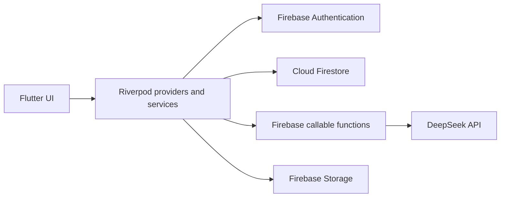

<div align="center">

# ZeroWaste Kitchen | Atıksız Mutfak

**Turn ingredients you already have into recipes, with a little help from AI.**

Flutter · Dart · Riverpod · Firebase · Cloud Functions · Turkish / English

[Project website](https://atiksizmutfak.com/) · [GitHub profile](https://github.com/AhmetKoca32)

</div>


## About the project

**ZeroWaste Kitchen (Atıksız Mutfak)** is a mobile application developed for an international **Erasmus+ KA210** project focused on food-waste awareness. It helps people discover ways to use ingredients they already have, explore recipes, and build more sustainable cooking habits.

This repository contains the **Flutter mobile app**, not the project's separate web platform.

**Project status (November 2026):** The Android app has completed Google Play closed testing. Preparation for the next testing stage is ongoing; this is **not** a claim of a general public release.

## Features

- **Cook with what you have:** Enter available ingredients and request AI-assisted recipe suggestions.
- **EcoChef assistant:** Chat-based cooking guidance and recipe ideas.
- **Recipe discovery:** Browse recipes, search, filter, and save favorites.
- **Curated recipes:** Browse a collection of recipes prepared for the project.
- **Gamification:** Points, daily activities, badges, levels, and leaderboard experiences.
- **Bilingual interface:** Turkish and English localization.

## Technology stack

| Area | Technologies |
| --- | --- |
| Mobile application | Flutter, Dart |
| State management | Riverpod |
| Navigation | go_router |
| Authentication and data | Firebase Authentication, Cloud Firestore |
| Backend functions | Firebase Cloud Functions, TypeScript, Node.js 22 |
| AI integration | DeepSeek API, accessed from server-side callable functions |
| Storage and protection | Firebase Storage, Firebase App Check |
| Localization | Flutter localization, `intl` |

AI requests are sent to callable Cloud Functions. The provider credential is configured as a **server-side secret**, rather than embedded in the Flutter application.

## Architecture



The primary areas of the repository are:

```text
lib/
  core/               # Shared services, providers, routing and UI
  features/
    chat/              # EcoChef conversation flows
    home/              # Main experience
    points/            # Gamification
    recipe_generator/  # Ingredient-based recipe generation
    splash/            # Entry experience
  l10n/                # Turkish and English localization
functions-ai/
  src/                 # Server-side AI callable functions
assets/data/
  recipes.json         # Bundled recipe data
```

## Run locally

### Prerequisites

- Flutter with a compatible Dart SDK (the project declares `^3.10.7`)
- Android or iOS development environment
- A Firebase project configured for your own environment

### Flutter application

```bash
git clone https://github.com/AhmetKoca32/zerowaste.git
cd zerowaste
flutter pub get
flutter run
```

**Note:** Fetching Flutter packages alone will not configure Firebase. Authentication providers, App Check, Firestore and Storage rules, and the callable functions must be configured appropriately. Do not use the original project's production credentials or publish service-account keys.

### AI Cloud Functions

The functions are maintained in a separate TypeScript project:

```bash
cd functions-ai
npm install
npm run build
```

The functions use a Firebase-managed `DEEPSEEK_API_KEY` secret. **Do not put the AI provider key in mobile code or a committed configuration file.** Building the functions does not deploy them.

## Development checks

```bash
flutter analyze
flutter test
```

These are commands for local verification; this README does not claim that a CI pipeline or a particular test suite has passed.

## Project context and contribution

This app was developed in the context of the **Erasmus+ ZeroWaste Kitchen** initiative, with contributions from an international project team.

**Ahmet Koca** was responsible for developing the Flutter mobile application, including AI-enabled user journeys and the application's interactive features. The broader initiative also involved research, design, web development, and other contributions from the project team.

## Links

- [ZeroWaste Kitchen project website](https://atiksizmutfak.com/)
- [Ahmet Koca on GitHub](https://github.com/AhmetKoca32)
- [Ahmet Koca on LinkedIn](https://www.linkedin.com/in/ahmetkocaa/)
